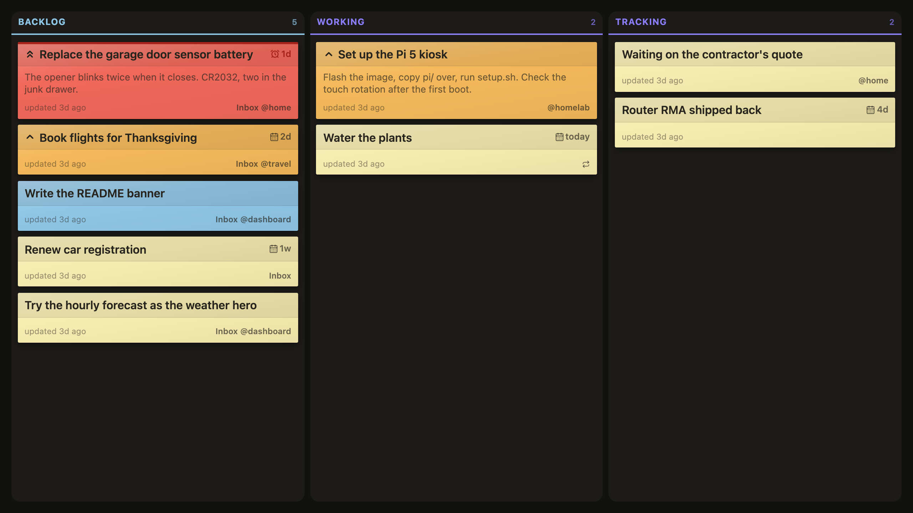
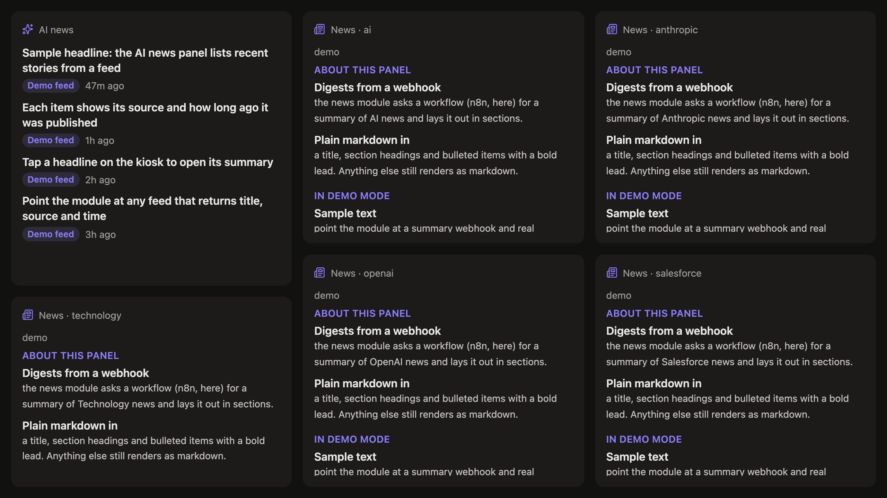

<p align="center"></p>

A modular, configurable dashboard for a touchscreen on the wall. Each panel is a small module
(tasks, calendar, weather, Slack, server stats) and a theme decides which ones go on which page.
It's built to run full-screen on a Raspberry Pi with a touch display, works in any browser, and
every open screen updates the moment the data changes.

<table>
  <tr>
    <td></td>
    <td></td>
  </tr>
  <tr>
    <td align="center"><sub><b>Tasks.</b> A Todoist project as a board. Drag a note between columns or tap Done; it syncs back.</sub></td>
    <td align="center"><sub><b>Glance.</b> Clock, Slack, weather, markets and the next three days.</sub></td>
  </tr>
  <tr>
    <td></td>
    <td></td>
  </tr>
  <tr>
    <td align="center"><sub><b>Status.</b> The server it runs on, refreshed every few seconds.</sub></td>
    <td align="center"><sub><b>News.</b> Headlines plus daily digests from an n8n workflow.</sub></td>
  </tr>
</table>

Swipe (or use the arrow keys) to change pages. After five minutes it drifts back to Tasks.

## Try it

You need Rust, Node 22+ and Docker (for a local Redis).

```sh
bin/setup                      # dependencies, dev tools, .env, Redis
bin/dev                        # server on :4000, UI on :5173, both reload on save
open "http://localhost:5173/?demo"
```

`?demo` runs the UI on made-up data with no server and no API keys. It's what the screenshots
above are taken from, and the Tasks board still works: drag cards around and complete them.
Drop `?demo` and add keys to `.env` to see your own data.

## How it works

```
 modules/*/module.lua          server (Rust)                     browser (React)
┌───────────────────┐   ┌──────────────────────────┐   websocket  ┌──────────────────┐
│ fetch → state     │──▶│ runs each module on its  │─────────────▶│ themes place     │
│ view  → widgets   │   │ schedule, keeps state in │◀─────────────│ <Slot>s on pages │
│ hooks, commands   │   │ Redis, serves /hooks     │   commands   │                  │
└───────────────────┘   └──────────────────────────┘              └──────────────────┘
```

**Modules** are small Lua files. A module fetches something on a schedule, returns plain state,
and says how to draw it: either a tree of built-in widgets (gauges, tickers, lists, charts) or a
React component that ships alongside it. Here's the stocks module, trimmed a little:

```lua
return {
  name = "stocks",
  icon = "chart-line",
  every = "30m",
  config = { symbols = { "CRM", "SPY", "VOO" } },

  fetch = function(ctx)
    local quotes = {}
    for _, symbol in ipairs(ctx.config.symbols) do
      local q = ctx.http.get("https://finnhub.io/api/v1/quote", {
        query = { symbol = symbol, token = ctx.env("FINNHUB_API_KEY") },
      })
      quotes[#quotes + 1] = { label = symbol, value = string.format("%.2f", q.c), delta = q.d }
    end
    return { quotes = quotes }
  end,

  view = function(state)
    return ui.ticker { items = state.quotes }
  end,
}
```

Modules run sandboxed in Luau, with only the host functions they're given: HTTP, time and
time zones, env vars and a few system stats. Anything specific to one service, like parsing a
calendar feed, lives in that module's own folder. Saving a module reloads it without restarting
anything.

**Themes** are React files that lay out pages. A `<Slot>` places a module, and any extra props
become that instance's config:

```tsx
<Page id="glance" title="Glance">
  <Row>
    <Slot module="clock" instance="home" tz="America/New_York" />
    <Slot module="weather" instance="home" zip="10001" title="Home · {{state.place}}" />
  </Row>
</Page>
```

The server only runs what some screen is showing, and a page you've swiped away from stops
polling until you come back.

**Hooks** let other systems push data in instead of the dashboard pulling it. The `slack` module
has no fetch at all; whatever counts the unread messages posts them:

```sh
curl -X POST http://localhost:4000/hooks/slack/push \
  -H "Authorization: Bearer $HOOKS_TOKEN" \
  -d '{"DMs": {"number": 2, "tone": "bad"}, "Mentions": {"number": 5}}'
```

Every hook publishes its schema and an example at `GET /hooks`, plus an OpenAPI document, so
whatever is sending to it (a cron job, n8n, an AI agent) can discover the contract on its own.

## What's included

| Module | Shows | Needs |
|---|---|---|
| `todoist` | a project as a draggable board | `TODOIST_API_TOKEN` |
| `calendar` | the next few days from one or more ICS feeds | `GOOGLE_CALENDAR_ICS_URL` |
| `weather` | now, hi/lo, sunrise/sunset and an hourly strip | `OPENWEATHERMAP_API_KEY` |
| `stocks` | quotes and the day's change | `FINNHUB_API_KEY` |
| `slack` | counts pushed by a hook; urgent ones ring | `HOOKS_TOKEN` on hosted servers |
| `news`, `ainews` | markdown digests and headlines from webhooks | `NEWS_SUMMARY_URL`, `NEWS_WEBHOOK_URL` |
| `clock` | digital or analog, any time zone | nothing |
| `system`, `redis` | CPU, memory, load, uptime, Redis usage | nothing |

## Running it for real

`bin/build --docker` produces a single image: the server, the built UI and the modules. It needs
a Redis and listens on `$PORT`, so it runs anywhere that runs a container; `bin/deploy` pushes
to [Dokku](https://dokku.com). A kiosk only needs a browser pointed at it. Every open screen
reloads itself when a new build ships, so a wall display never needs a hand to update.

## Where it's going

The bundled `wall` theme is one specific layout, with its Todoist project, location and news
topics written into it. Next up is separating reusable layouts from personal ones: a sensible
default theme in the repo, and custom themes and settings kept outside it.

## Docs

- [Writing a module](docs/modules.md): state, views, custom components, commands and hooks
- [Themes and layout](docs/themes.md): pages, rows, columns and `<Slot>` props
- [Hooks](docs/hooks.md): pushing data in, auth options, `bin/hook`
- [Pi kiosk](docs/pi-kiosk.md): turning a Raspberry Pi and a touch display into the wall screen
- [Deploying with Dokku](docs/deploy/dokku.md)

## Development

| Script | Does |
|---|---|
| `bin/setup` | installs dependencies and dev tools, creates `.env`, starts Redis |
| `bin/dev` | runs everything with live reload |
| `bin/test` | Rust and frontend tests |
| `bin/build` | release build (`--docker` for the image) |
| `bin/run` | runs the release build locally |
| `bin/deploy` | pushes to Dokku (staging by default) |
| `bin/hook` | lists, describes and posts to hooks |
| `bin/screenshots` | regenerates the images in this README from demo mode |
| `bin/pi` | sets up and updates the kiosk Pi over ssh |

`?theme=<name>` picks a theme and `?debug=1` logs every websocket message to the console.
