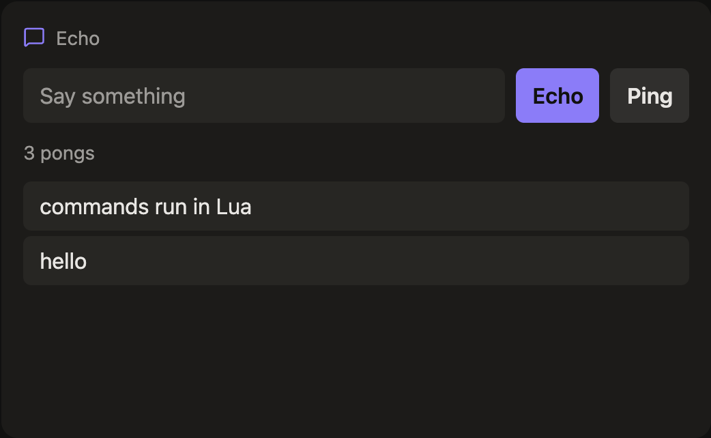

# Writing a module

A module is a folder under `modules/` with a `module.lua`, and optionally a `ui/index.tsx` for a
custom React view. The folder name is the module name. The server loads every module at start
and, in development, reloads one the moment you save it.

`lua/dashboard.d.lua` has type annotations for everything below. Point your editor's Lua
language server at it and `---@type Module` gives you completion.

## The shape

```lua
---@type Module
return {
  name = "weather",                 -- must match the folder
  icon = "cloud-sun",               -- header icon: a Lucide name
  title = "Weather: {{config.zip}}",-- header title, a template over config, state and status
  every = "10m",                    -- or cron = "*/30 9-16 * * 1-5" (in the TZ env var's zone)
  config = {                        -- defaults; a <Slot> or application.lua can override any of them
    zip = required,                 -- no default: every instance must pass it
    units = "imperial",
  },
  fetch = function(ctx) ... end,    -- returns the new state (a plain table), or nil for "no change"
  view = function(state, config) ... end,  -- a widget tree; or `component = "Weather"` instead
}
```

An **instance** is a module plus config. `<Slot module="weather" instance="home" zip="10001" />`
creates the instance `weather:home`; two slots with different instance names get two independent
copies with their own state and schedule.

## Fetching

`fetch(ctx)` runs on the schedule, but only while some screen shows the instance (or the slot says
`poll="always"`). A module with `fetch` and no schedule runs it once, the first time a screen shows
the instance, to set its starting state. Whatever it returns becomes the state and is pushed to every screen. If it
raises, the old state stays on screen with an error badge, and the server retries with backoff.

What `ctx` offers:

| | |
|---|---|
| `ctx.config` | the instance's config: module defaults overlaid with what the slot passed |
| `ctx.state` | the current state (nil before the first fetch) |
| `ctx.http.get(url, opts)`, `ctx.http.post(url, opts)` | `opts`: `query`, `headers`, `json`, `body`, `timeout`; returns decoded JSON, or text |
| `ctx.env(name)` | an environment variable, for API keys; raises if unset |
| `ctx.now()`, `ctx.today()` | unix seconds, and `YYYY-MM-DD` in the host zone |
| `ctx.instant(wall, zone)` | a wall-clock time in an IANA zone as `{ epoch, iso }`; the one piece of date handling Lua can't do |
| `ctx.sys.stats()`, `ctx.redis.info()` | host CPU, memory, load and uptime; Redis usage |
| `ctx.refresh()` | run `fetch` again right after this returns |
| `ctx.log(level, msg)` | to the server log |

Keep upstream URLs in the module and secrets in the environment. Config can be set by any screen,
so it should never decide where requests go or carry a key.

## More than one file

A module can split its code into other `.lua` files in its own folder and load them with
`require("name")`. Each file loads once per instance, and only files in the module's folder are
reachable, so a module stays a folder you can copy anywhere. The calendar module keeps its
iCalendar parser in `modules/calendar/ics.lua` this way.

## Drawing with widgets

`view(state, config)` returns a tree of built-in widgets. The browser renders it inside the
module's frame, so a module with a `view` needs no frontend code at all. [widgets.md](widgets.md)
shows every widget with a picture, its Lua and its options.

| Widget | For |
|---|---|
| `ui.stat { value, label, sub, icon }` | one big number |
| `ui.gauge { value, max, unit, label, sub, icon, stops, big }` | a half-circle meter; `stops = { [75] = "yellow", [90] = "red" }` |
| `ui.ticker { items }` | label / value / change rows, colored by `delta` |
| `ui.line { points, min, max, unit, height }` | a sparkline, oldest point first |
| `ui.bar { items }`, `ui.donut { items, center }` | small charts |
| `ui.list { ... }` and `ui.row { title, meta, badge, on_tap }` | tappable lists |
| `ui.text { text }`, `ui.badge { text, tone }`, `ui.icon { name }` | text bits |
| `ui.clock { tz, style, format, date }` | a clock that ticks in the browser |
| `ui.group { direction, gap, ... }` | stack any of the above |

## Components and commands, end to end

`modules/echo` is a complete, small example: a text box that echoes what you type and a Ping
button that counts pongs. Open the dashboard with `?theme=gallery` to try it.



Four pieces connect it:

**1. `fetch` sets the state.** The server keeps it and sends it to every screen showing the
instance. With no schedule, it runs once, when the instance is first shown.

```lua
fetch = function(ctx)
  return ctx.state or { messages = json.array({}), pings = 0 }
end,
```

**2. `component` names the React export that draws it**, instead of a `view`.

```lua
component = "Echo",   -- the Echo export of modules/echo/ui/index.tsx
```

**3. The component calls `send`** to run a command. It never changes `state` itself.

```tsx
export function Echo({ state, send }: CustomProps) {
  ...
  await send("echo", { text });   // resolves when the command finishes; rejects with its error
```

**4. A command returns the new state.** The server stores it and pushes it to every screen, so
the component re-renders with it, here and on any other screen showing the same instance.

```lua
commands = {
  echo = function(ctx, args)
    local text = type(args.text) == "string" and args.text:match("^%s*(.-)%s*$") or ""
    if text == "" then error("say something first", 0) end
    ...
    return { messages = messages, pings = ctx.state.pings }
  end,
  ping = function(ctx)
    return { messages = json.array(ctx.state.messages), pings = ctx.state.pings + 1 }
  end,
},
```

A few details worth knowing:

- **Errors** a command raises reject `send` with their message. Pass level `0` to `error` so the
  message doesn't start with Lua's `file:line:`.
- **Returning nothing** leaves the state alone. Call `ctx.refresh()` instead when the real answer
  comes from upstream: the Todoist board's `move` and `complete` post to Todoist, then refresh.
- **Widgets run commands too.** In a `view`, `ui.row { on_tap = cmd("open", { id = 7 }) }` sends
  `open` when tapped, with no component at all.
- **Empty lists** need `json.array({})`, or they reach the screen as `{}`.

### What a component receives

```ts
type CustomProps = {
  state: JsonValue | null;          // what fetch or the last command returned
  config: Record<string, JsonValue>;
  status: Status | null;            // ok, error, fetched_at, ...
  send: (action: string, args?: JsonValue) => Promise<void>;
  title: string;
  density: "compact" | "normal" | "large";
};
```

Components live in `modules/<name>/ui/index.tsx`, are found at build time and load only when a
screen shows them. A component owns its whole slot, header included; a slot can ask for the
standard frame with `chrome="full"`. One file can export several components, and a slot picks
another with `component="TodoistList"`.

## Hooks

A module can also take data pushed from outside instead of, or as well as, fetching it. See
[hooks.md](hooks.md).
