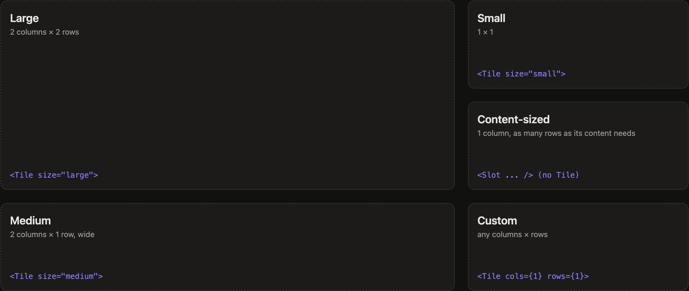

# Themes and layout

A theme is a folder with an `index.tsx` (the layout) and a `tokens.css` (colors and font). The repo
ships `home` (the default) and `gallery` (every widget, for reference) in `web/themes/`; your own go
in `local/themes/` or any folder in `THEMES_DIR`. `?theme=<name>` picks one, and `DEFAULT_THEME`
sets the one that opens without it. Import app pieces through `@dashboard/...` so a theme works
from any folder.

## Pages

```tsx
<Pages home="tasks" returnHomeAfter="5m">
  <Page id="tasks" title="Tasks">...</Page>
  <Page id="glance" title="Glance">...</Page>
</Pages>
```

Pages sit side by side and move one at a time: swipe, use the arrow keys, or click the dots. With
`returnHomeAfter` (`"30s"`, `"5m"`, `"1h"`), the screen goes back to `home` after that long without
a touch; leave it out, or set it to `0`, to stay on whatever page was last shown. `RETURN_HOME_AFTER`
in the environment overrides it for every screen the server serves, without editing the theme. The current
page survives a reload.

A page that isn't showing keeps its data live (pushes still arrive) but stops its modules from
polling. Showing it again fetches anything that went stale while it was away.

## Flow and tiles

`<Flow>` is the easy default for a page of panels. It works like a phone's home screen of widgets:
equal columns on a grid of rows. Each panel is as tall as its content, rounded up to whole rows, so
two short panels stack to exactly the height of a tall one beside them, and gaps get packed.

```tsx
<Flow>
  <Slot module="weather" instance="home" />
  <Tile size="large"><Slot module="calendar" feeds="home" /></Tile>
  <Tile rows={2}><Slot module="system" /></Tile>
  <Slot module="openrouter" />
</Flow>
```



Wrap a panel in `<Tile>` to choose its size instead (sizes follow iOS widgets):

| `<Tile>` | Columns × rows |
|---|---|
| `size="small"` | 1 × 1 |
| `size="medium"` | 2 × 1 (wide) |
| `size="large"` | 2 × 2 |
| `cols={n} rows={n}` | any |

`<Flow>` takes `width` (the narrowest a column gets, in rem; default 22), `unit` (one row's height,
in rem; default 10) and `gap` (default 6, in quarter-rem steps like the other containers). For exact
placement, use rows, columns or a grid instead.

## Rows, columns and grids

`<Row>` and `<Column>` split the space evenly; give a child (a slot, or a nested row or column)
`size` to change its share (`2` for twice as much, or a length like `"40%"`). `<Grid areas={[...]} columns="..." rows="...">` is a CSS
grid with named areas, for layouts rows and columns can't express; place a slot with `area`.

## Tabs

`<Tabs>` puts several panels in one place, picked with an iOS segmented control. Every tab stays
mounted, so its modules keep their data and switching is instant. With `id`, the chosen tab survives
a reload.

```tsx
<Tabs id="digest">
  <Tab title="AI"><Slot module="news" instance="ai" topic="ai" /></Tab>
  <Tab title="Technology"><Slot module="news" instance="tech" topic="technology" /></Tab>
</Tabs>
```

Panels that scroll use the `scroll` class: touch panning that stays inside the panel, a thin
indicator instead of a scrollbar, and a fade at the bottom while there's more below.

## Slot

```tsx
<Slot module="weather" instance="home" zip="10001" title="Home · {{state.place}}" chrome="full" />
```

| Prop | |
|---|---|
| `module` | which module |
| `instance` | names this copy; the instance id becomes `module:instance` |
| `title` | header text, a template over `config`, `state` and `status` |
| `icon` | header icon, overriding the module's |
| `size` | `"compact"`, `"normal"` or `"large"` text, or a layout share as above |
| `chrome` | `"full"` (header and frame), `"minimal"` or `"none"` |
| `component` | another component exported by the module's `ui/index.tsx` |
| `poll="always"` | keep fetching even when no screen shows it |
| anything else | config for the module (`zip`, `days`, `symbols`...) |

Slots declare their instance to the server while they're mounted; nothing else needs to know
about them. `application.lua` is only for instances that must run with no screen open.

## Tokens

`tokens.css` sets the theme's palette as CSS variables: `--t-canvas`, `--t-panel`, `--t-ink`,
`--t-ink-muted`, `--t-accent`, the `good`/`warn`/`bad` tones, the sticky-note papers and the font.
The root font size follows the viewport, so a layout drawn for the 1280×720 kiosk scales to any
screen.
