<!-- Generated by bin/screenshots from web/themes/gallery/examples.ts. Edit that file, not this one. -->

# Widgets

A module's `view(state, config)` returns a tree of these widgets, and the screen draws it inside
the module's panel. Nothing here needs frontend code. When a widget doesn't fit, a module can ship
its own React component instead: see [modules.md](modules.md).

Open the dashboard with `?theme=gallery` to see every widget live.

Widgets: [stat](#uistat) · [gauge](#uigauge) · [ticker](#uiticker) · [line](#uiline) · [bar](#uibar) · [donut](#uidonut) · [list](#uilist) · [text](#uitext) · [markdown](#uimarkdown) · [image](#uiimage) · [audio](#uiaudio) · [badge](#uibadge) · [icon](#uiicon) · [clock](#uiclock) · [group](#uigroup)

## ui.stat

One figure with a label, a smaller line under it and an optional icon.

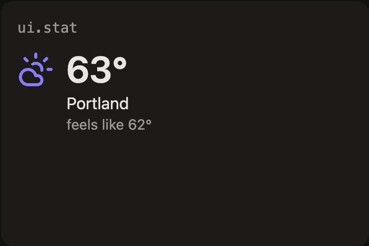

```lua
ui.stat { value = "63°", label = "Portland", sub = "feels like 62°", icon = "cloud-sun" }
```

| Option | |
|---|---|
| `value` | the figure, as text |
| `label` | what it is |
| `sub` | a smaller line underneath |
| `icon` | a Lucide icon name |

## ui.gauge

A half-circle meter. Its color changes as the value passes each stop.

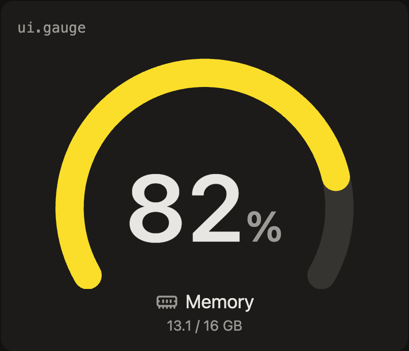

```lua
ui.gauge {
  value = 82, unit = "%", label = "Memory", sub = "13.1 / 16 GB", icon = "memory-stick",
  stops = { [75] = "yellow", [90] = "red" }, big = true,
}
```

| Option | |
|---|---|
| `value`, `max` | the reading and the full scale (default 100) |
| `unit`, `label`, `sub`, `icon` | text around the figure |
| `stops` | `{ [75] = "yellow", [90] = "red" }`: the color from each threshold up; names map to theme tones, anything else is a CSS color |
| `tone` | the color below the first stop (default the theme accent) |
| `big` | `true` to fill the whole panel; without it the gauge is a compact inline meter |

## ui.ticker

Rows of label, value and change, colored up or down.

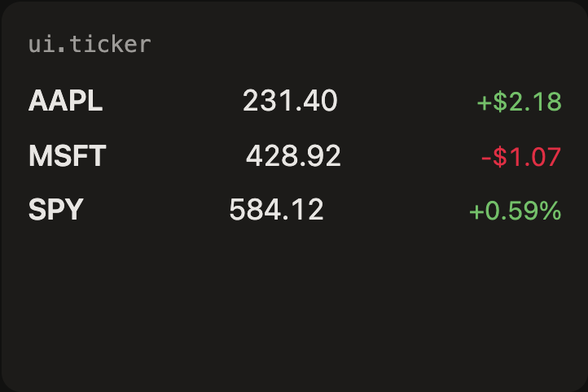

```lua
ui.ticker { items = {
  { label = "AAPL", value = "231.40", delta = 2.18, change = "+$2.18" },
  { label = "MSFT", value = "428.92", delta = -1.07, change = "-$1.07" },
  { label = "SPY", value = "584.12", delta = 0.59 },
} }
```

| Option | |
|---|---|
| `items` | `{ label, value, delta?, change? }`; `delta` picks the color, `change` is the text shown (else `delta` as a percent) |

## ui.line

A sparkline over a list of numbers, oldest first, with the latest value as text.

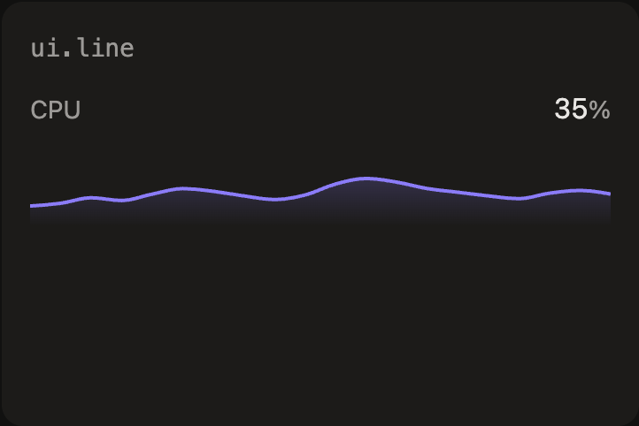

```lua
ui.line { points = state.cpu_history, label = "CPU", unit = "%", min = 0, max = 100 }
```

| Option | |
|---|---|
| `points` | numbers, oldest first |
| `label`, `unit` | text for the latest value |
| `min`, `max` | fix the scale (default: fit the data) |
| `tone` | `accent`, `good`, `warn` or `bad` |
| `height` | in em (default 3.5), or `"fill"` for the whole panel |

## ui.bar

Vertical bars with labels and values underneath.

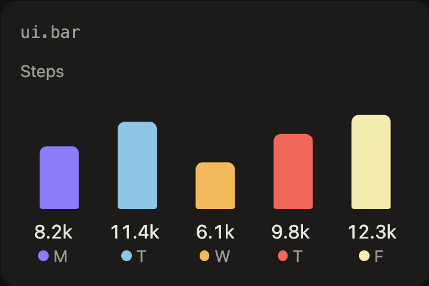

```lua
ui.bar { label = "Steps", unit = "k", items = {
  { label = "M", value = 8.2 }, { label = "T", value = 11.4 }, { label = "W", value = 6.1 },
  { label = "T", value = 9.8 }, { label = "F", value = 12.3 },
} }
```

| Option | |
|---|---|
| `items` | `{ label, value }` |
| `label`, `unit` | a caption and the unit after each value |

## ui.donut

Parts of a whole, with a legend and a figure in the middle.

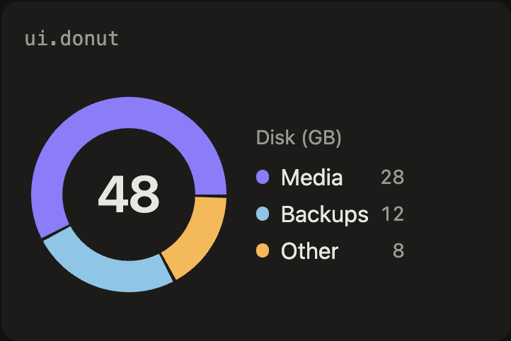

```lua
ui.donut { center = 48, label = "Disk (GB)", items = {
  { label = "Media", value = 28 }, { label = "Backups", value = 12 }, { label = "Other", value = 8 },
} }
```

| Option | |
|---|---|
| `items` | `{ label, value }` |
| `center` | text in the hole |
| `label` | a caption |

## ui.list

Tappable rows. A row's `on_tap` runs one of the module's commands.

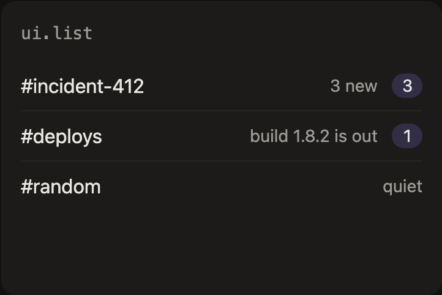

```lua
ui.list { empty = "Nothing waiting",
  ui.row { title = "#incident-412", meta = "3 new", badge = 3, on_tap = cmd("open", { channel = "incident-412" }) },
  ui.row { title = "#deploys", meta = "build 1.8.2 is out", badge = 1 },
  ui.row { title = "#random", meta = "quiet" },
}
```

| Option | |
|---|---|
| `(children)` | `ui.row`s, as array entries or `children` |
| `empty` | shown when there are no rows |
| `row: title`, `meta`, `badge` | the row's text and a count |
| `row: on_tap` | `cmd("name", args)`: runs that command when tapped |

## ui.text

Short markdown for digests: bold, italics, inline code, lists and small headings. For anything richer, use ui.markdown.

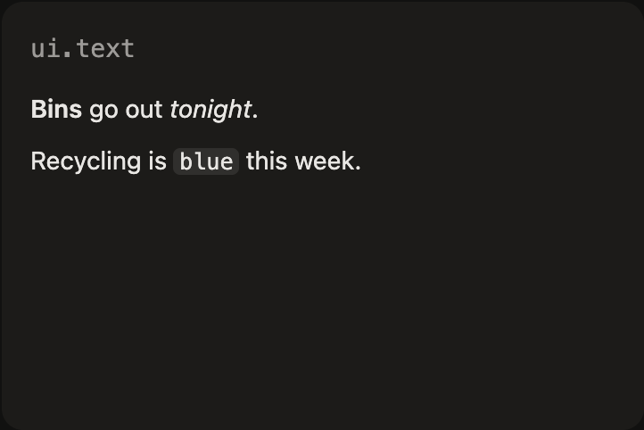

```lua
ui.text { text = "**Bins** go out *tonight*.\n\nRecycling is `blue` this week." }
```

| Option | |
|---|---|
| `text` | markdown |

## ui.markdown

Full markdown for a rich tile: headings, links, task lists, tables, code blocks, quotes and images. Raw HTML is never rendered.

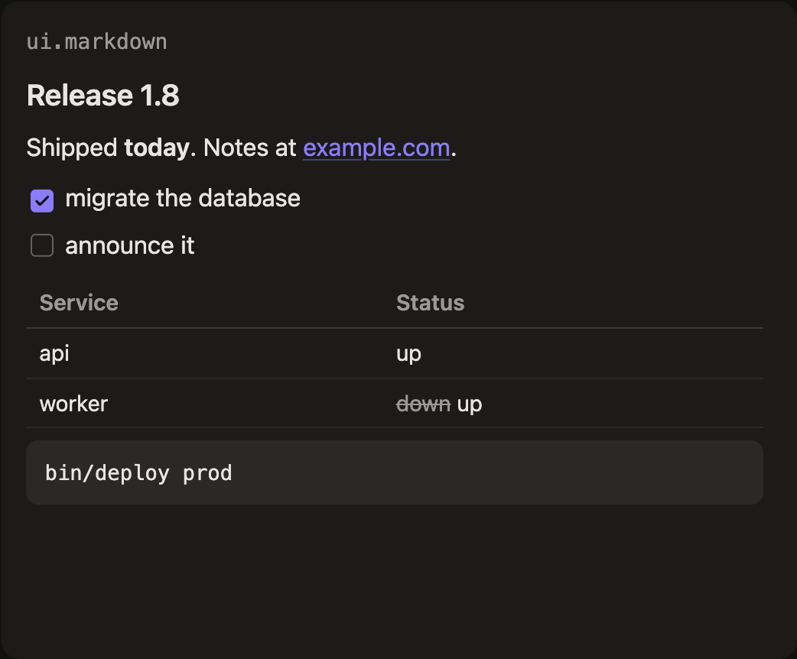

```lua
ui.markdown { text = [[
## Release 1.8

Shipped **today**. Notes at [example.com](https://example.com).

- [x] migrate the database
- [ ] announce it

| Service | Status |
|---|---|
| api | up |
| worker | ~~down~~ up |

```sh
bin/deploy prod
```
]] }
```

| Option | |
|---|---|
| `text` | markdown, GitHub-flavoured |
| `links` | `false` renders links as plain text, for screens that must never navigate away (default: links open in a new tab) |

## ui.image

An image, inline as base64 (`data`) or from a URL (`src`). Pairs with openrouter.image() for generated pictures.

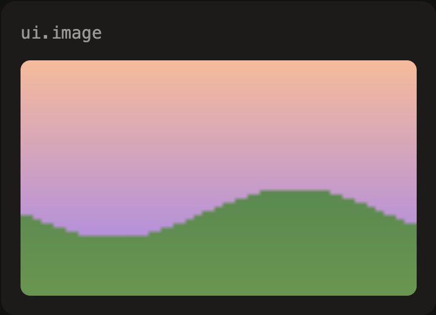

```lua
local picture = openrouter.image(ctx, "A watercolor of the garden at dawn")  -- in fetch

ui.image { data = state.picture.data, type = state.picture.type, alt = "The garden at dawn" }
-- or: ui.image { src = "https://example.com/garden.jpg", alt = "The garden" }
```

| Option | |
|---|---|
| `data`, `type` | base64 image data and its type (default image/png); a full data: URL works too |
| `src` | an image URL, instead of data |
| `alt` | what the image shows |
| `fit` | `contain` (default) or `cover` |

## ui.audio

A clip with a play button, inline as base64 or from a URL. With autoplay, each new clip plays as it arrives: an announcement.

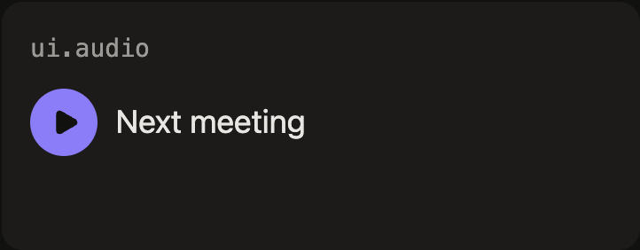

```lua
local clip = openrouter.speak(ctx, "Your 3pm is in ten minutes")  -- in fetch

ui.audio { data = state.clip.data, type = state.clip.type, label = "Next meeting", autoplay = true }
```

| Option | |
|---|---|
| `data`, `type` | base64 audio and its type (default audio/mpeg); a full data: URL works too |
| `src` | an audio URL, instead of data |
| `label` | shown beside the button |
| `autoplay` | `true` plays each new clip as it arrives (not the one already there when the page loads) |

## ui.badge

A small count or label in a tone.

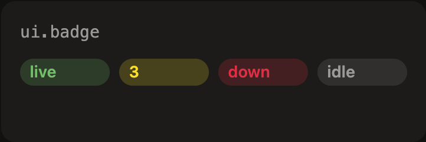

```lua
ui.group { direction = "row", gap = 2,
  ui.badge { text = "live", tone = "good" },
  ui.badge { text = 3, tone = "warn" },
  ui.badge { text = "down", tone = "bad" },
  ui.badge { text = "idle", tone = "muted" },
}
```

| Option | |
|---|---|
| `text` | a string or number |
| `tone` | `good`, `warn`, `bad` or `muted` |

## ui.icon

A Lucide icon by name, sized in pixels and colored like the text around it.

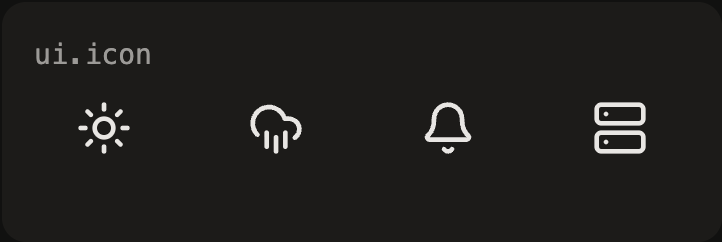

```lua
ui.group { direction = "row", gap = 4,
  ui.icon { name = "sun", size = 28 }, ui.icon { name = "cloud-rain", size = 28 },
  ui.icon { name = "bell", size = 28 }, ui.icon { name = "server", size = 28 },
}
```

| Option | |
|---|---|
| `name` | a Lucide icon name from web/src/widgets/icons.tsx |
| `size` | in px (default 20) |

## ui.clock

A clock that ticks in the browser, digital or analog, in any time zone.

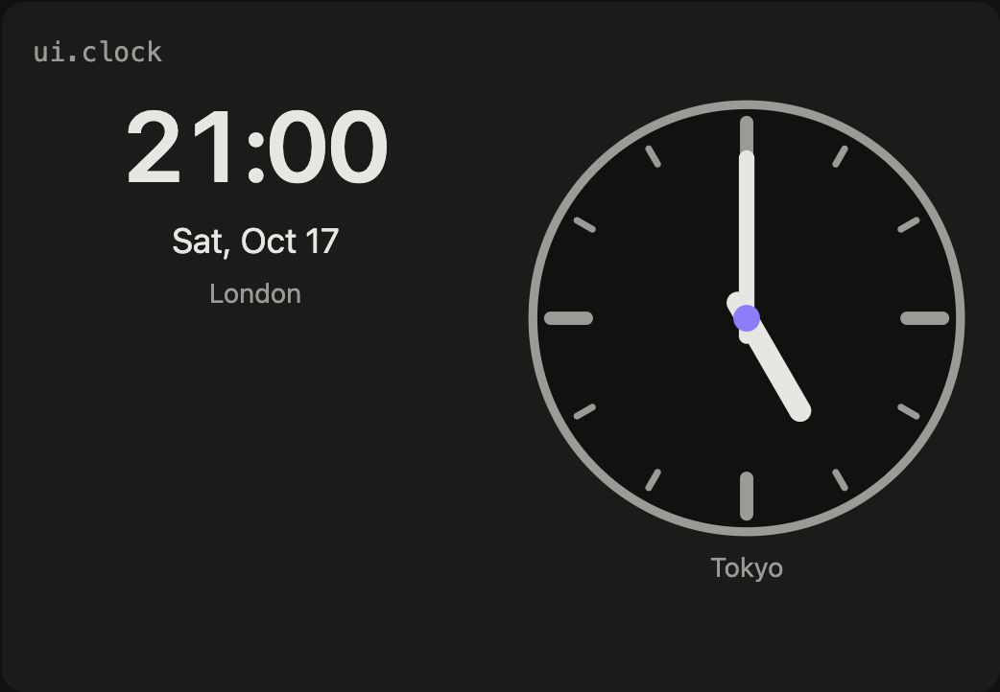

```lua
ui.group { direction = "row", gap = 6,
  ui.clock { tz = "Europe/London", label = "London", date = "ddd, MMM D" },
  ui.clock { tz = "Asia/Tokyo", label = "Tokyo", style = "analog" },
}
```

| Option | |
|---|---|
| `tz` | an IANA time zone |
| `label` | a caption |
| `style` | `digital` or `analog` |
| `seconds` | `true` to show seconds |
| `format` | e.g. `h:mm a` |
| `date` | `true`, or a format like `dddd, MMMM D` |

## ui.group

Stacks other widgets in a row or a column. Most views are a group at the top.

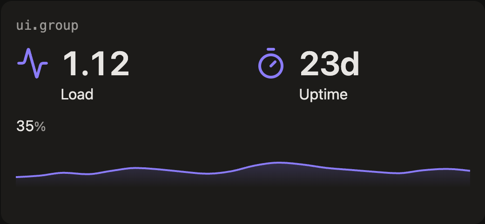

```lua
ui.group { direction = "column", gap = 3,
  ui.group { direction = "row", gap = 6,
    ui.stat { value = "1.12", label = "Load", icon = "activity" },
    ui.stat { value = "23d", label = "Uptime", icon = "timer" },
  },
  ui.line { points = state.cpu_history, unit = "%", min = 0, max = 100 },
}
```

| Option | |
|---|---|
| `direction` | `column` (default) or `row` |
| `gap` | space between children, in quarter-rem steps |
| `(children)` | any widgets, as array entries or `children` |
