<!-- Generated by bin/screenshots from web/themes/gallery/examples.ts. Edit that file, not this one. -->

# Widgets

A module's `view(state, config)` returns a tree of these widgets, and the screen draws it inside
the module's panel. Nothing here needs frontend code. When a widget doesn't fit, a module can ship
its own React component instead: see [modules.md](modules.md).

Open the dashboard with `?demo&theme=gallery` to see every widget live, a page per group.

Widgets: [stat](#uistat) · [gauge](#uigauge) · [progress](#uiprogress) · [ticker](#uiticker) · [line](#uiline) · [bar](#uibar) · [donut](#uidonut) · [text](#uitext) · [markdown](#uimarkdown) · [list](#uilist) · [badge](#uibadge) · [icon](#uiicon) · [toggle](#uitoggle) · [slider](#uislider) · [choice](#uichoice) · [button](#uibutton) · [image](#uiimage) · [audio](#uiaudio) · [title](#uititle) · [clock](#uiclock) · [group](#uigroup)

## ui.stat

One figure with a label, a smaller line under it and an optional icon.


```lua
ui.stat { value = "63°", label = "Portland", sub = "feels like 62°", icon = "cloud-sun" }
```

| Option | |
|---|---|
| `value` | the figure, as text |
| `label` | what it is |
| `sub` | a smaller line underneath |
| `icon` | a Lucide icon name |

### Without an icon

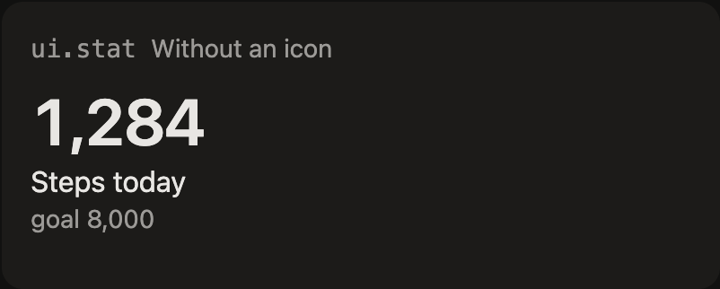

```lua
ui.stat { value = "1,284", label = "Steps today", sub = "goal 8,000" }
```

## ui.gauge

A half-circle meter. Its color changes as the value passes each stop.


```lua
ui.gauge {
  value = 82,
  unit = "%",
  label = "Memory",
  sub = "13.1 / 16 GB",
  icon = "memory-stick",
  stops = { [75] = "yellow", [90] = "red" },
  big = true,
}
```

| Option | |
|---|---|
| `value`, `max` | the reading and the full scale (default 100) |
| `unit`, `label`, `sub`, `icon` | text around the figure |
| `stops` | `{ [75] = "yellow", [90] = "red" }`: the color from each threshold up; names map to theme tones, anything else is a CSS color |
| `tone` | the color below the first stop (default the theme accent) |
| `big` | `true` to fill the whole panel; without it the gauge is a compact inline meter |

### Low and green

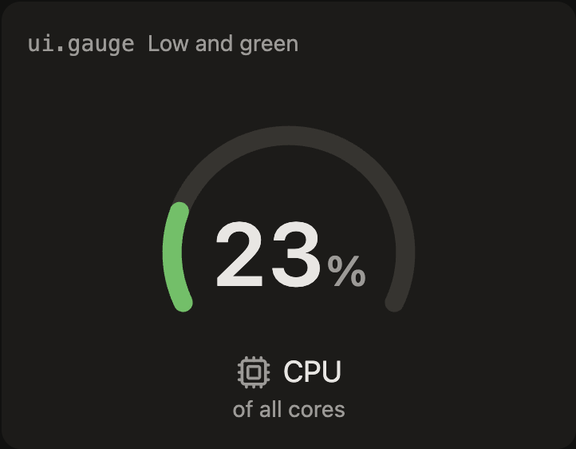

```lua
ui.gauge {
  value = 23,
  unit = "%",
  label = "CPU",
  sub = "of all cores",
  icon = "cpu",
  stops = { [70] = "yellow", [90] = "red" },
  big = true,
}
```

### Past the red stop

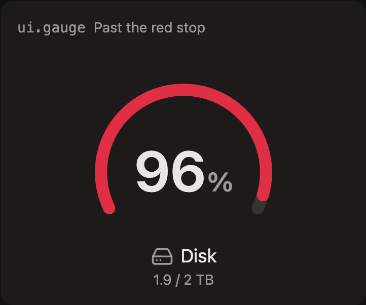

```lua
ui.gauge {
  value = 96,
  unit = "%",
  label = "Disk",
  sub = "1.9 / 2 TB",
  icon = "hard-drive",
  stops = { [75] = "yellow", [90] = "red" },
  big = true,
}
```

### A fixed tone

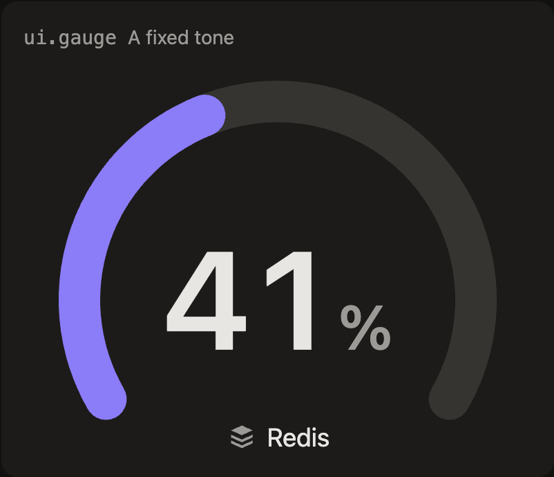

```lua
ui.gauge {
  value = 41,
  unit = "%",
  label = "Redis",
  icon = "redis",
  tone = "purple",
  big = true,
}
```

### Compact, in a row

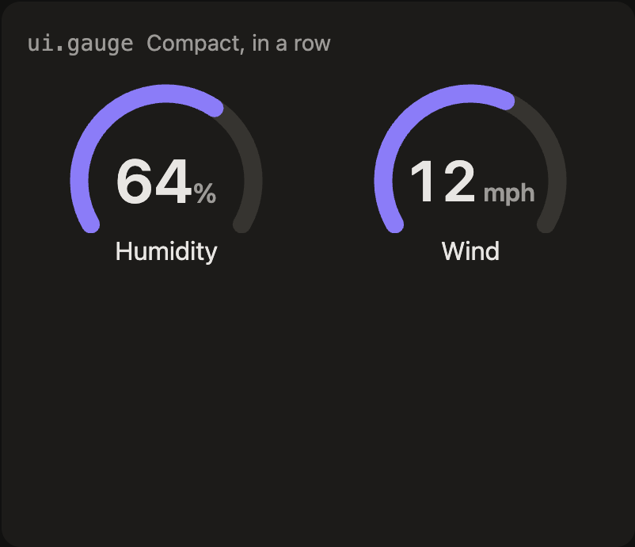

```lua
ui.group {
  direction = "row",
  gap = 4,
  ui.gauge { value = 64, unit = "%", label = "Humidity" },
  ui.gauge { value = 12, max = 20, unit = " mph", label = "Wind" },
}
```

## ui.progress

A horizontal bar of value out of max. Stops color it by how full it is, so a balance can turn yellow, then red, as it runs down.

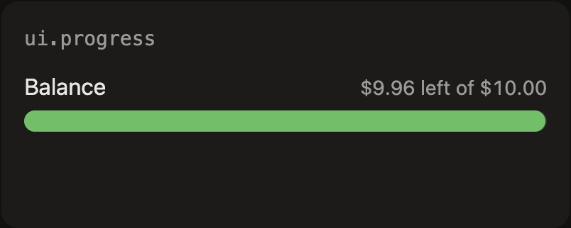

```lua
ui.progress {
  value = 9.96,
  max = 10,
  label = "Balance",
  text = "$9.96 left of $10.00",
  stops = { [0] = "red", [10] = "yellow", [25] = "green" },
}
```

| Option | |
|---|---|
| `value`, `max` | how full (max defaults to 100) |
| `label`, `text` | a label, and text on the right |
| `stops` | `{ [0] = "red", [10] = "yellow", [25] = "green" }`: the color from each percent up |
| `tone` | the color without stops (default the theme accent) |

### Running low

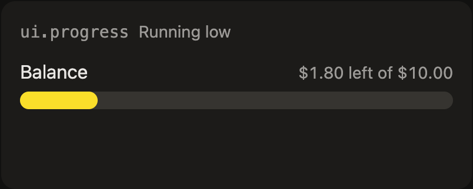

```lua
ui.progress {
  value = 1.8,
  max = 10,
  label = "Balance",
  text = "$1.80 left of $10.00",
  stops = { [0] = "red", [10] = "yellow", [25] = "green" },
}
```

### Nearly out

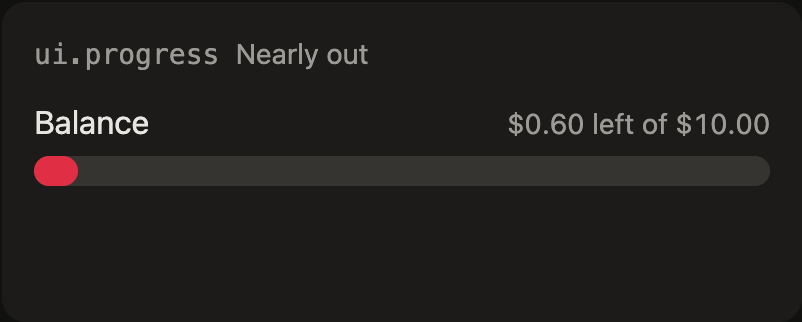

```lua
ui.progress {
  value = 0.6,
  max = 10,
  label = "Balance",
  text = "$0.60 left of $10.00",
  stops = { [0] = "red", [10] = "yellow", [25] = "green" },
}
```

### Plain, in the accent

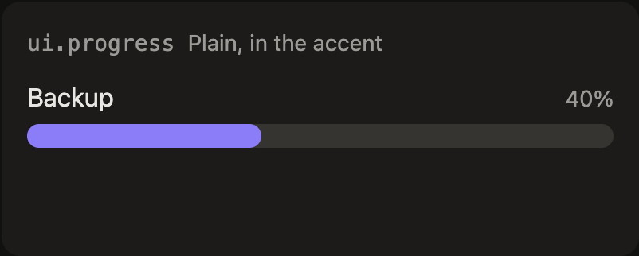

```lua
ui.progress { value = 40, label = "Backup", text = "40%" }
```

## ui.ticker

Rows of label, value and change, colored up or down.


```lua
ui.ticker {
  items = { { label = "AAPL", value = "231.40", delta = 2.18, change = "+$2.18" }, { label = "MSFT", value = "428.92", delta = -1.07, change = "-$1.07" }, { label = "SPY", value = "584.12", delta = 0.59 } },
}
```

| Option | |
|---|---|
| `items` | `{ label, value, delta?, change? }`; `delta` picks the color, `change` is the text shown (else `delta` as a percent) |

### Percent changes

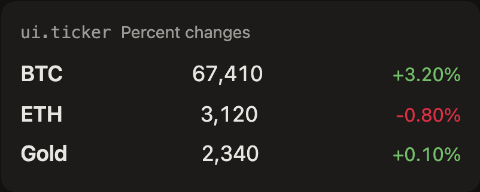

```lua
ui.ticker {
  items = { { label = "BTC", value = "67,410", delta = 3.2 }, { label = "ETH", value = "3,120", delta = -0.8 }, { label = "Gold", value = "2,340", delta = 0.1 } },
}
```

## ui.line

A sparkline over a list of numbers, oldest first, with the latest value as text.


```lua
ui.line {
  points = { 22, 25, 31, 28, 35, 41, 38, 33, 29, 34, 46, 52, 48, 41, 37, 33, 30, 36, 39, 35 },
  label = "CPU",
  unit = "%",
  min = 0,
  max = 100,
}
```

| Option | |
|---|---|
| `points` | numbers, oldest first |
| `label`, `unit` | text for the latest value |
| `min`, `max` | fix the scale (default: fit the data) |
| `tone` | `accent`, `good`, `warn` or `bad` |
| `height` | in em (default 3.5), or `"fill"` for the whole panel |

### A tone and its own range

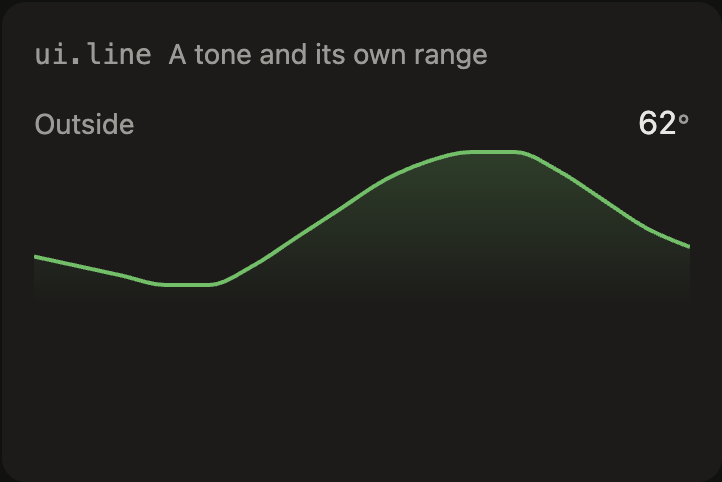

```lua
ui.line {
  points = { 61, 60, 59, 58, 58, 60, 63, 66, 69, 71, 72, 72, 70, 67, 64, 62 },
  label = "Outside",
  unit = "°",
  tone = "good",
  height = 5,
}
```

## ui.bar

Vertical bars with labels and values underneath.


```lua
ui.bar {
  label = "Steps",
  unit = "k",
  items = { { label = "M", value = 8.2 }, { label = "T", value = 11.4 }, { label = "W", value = 6.1 }, { label = "T", value = 9.8 }, { label = "F", value = 12.3 } },
}
```

| Option | |
|---|---|
| `items` | `{ label, value }` |
| `label`, `unit` | a caption and the unit after each value |

## ui.donut

Parts of a whole, with a legend and a figure in the middle.


```lua
ui.donut {
  center = 48,
  label = "Disk (GB)",
  items = { { label = "Media", value = 28 }, { label = "Backups", value = 12 }, { label = "Other", value = 8 } },
}
```

| Option | |
|---|---|
| `items` | `{ label, value }` |
| `center` | text in the hole |
| `label` | a caption |

### A budget

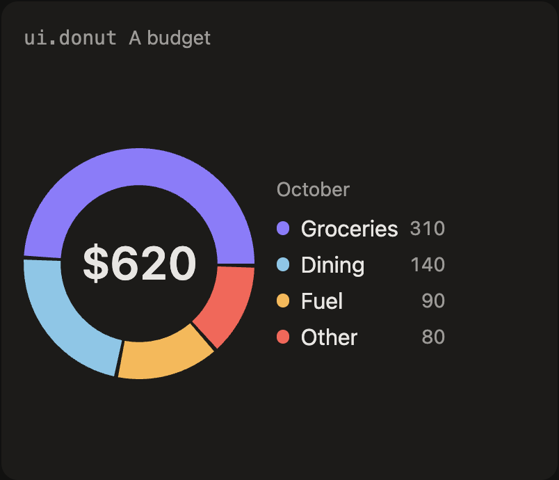

```lua
ui.donut {
  center = "$620",
  label = "October",
  items = { { label = "Groceries", value = 310 }, { label = "Dining", value = 140 }, { label = "Fuel", value = 90 }, { label = "Other", value = 80 } },
}
```

## ui.text

Short markdown for digests: bold, italics, inline code, lists and small headings. For anything richer, use ui.markdown.


```lua
ui.text { text = "**Bins** go out *tonight*.\n\nRecycling is `blue` this week." }
```

| Option | |
|---|---|
| `text` | markdown |

### A digest

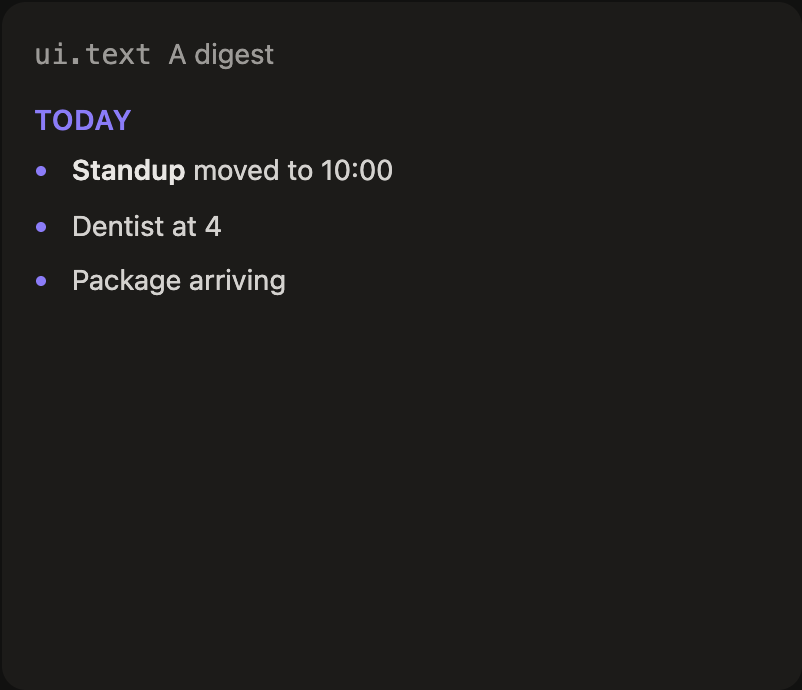

```lua
ui.text { text = "### Today\n- **Standup** moved to 10:00\n- Dentist at 4\n- Package arriving" }
```

## ui.markdown

Full markdown for a rich tile: headings, links, task lists, tables, code blocks, quotes and images. Raw HTML is never rendered.


```lua
ui.markdown { text = [[
## Release 1.8

Shipped **today**. Notes at [example.com](https://example.com).

- [x] migrate the database
- [ ] announce it

| Service | Status |
|---|---|
| api | up |
| worker | ~~down~~ up |

```sh
bin/deploy prod
```
]] }
```

| Option | |
|---|---|
| `text` | markdown, GitHub-flavoured |
| `links` | `false` renders links as plain text, for screens that must never navigate away (default: links open in a new tab) |

### Links as plain text

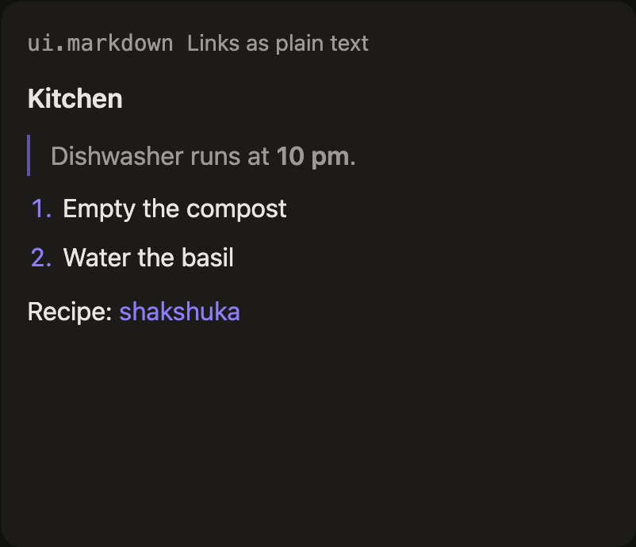

```lua
ui.markdown { links = false, text = [[
### Kitchen

> Dishwasher runs at **10 pm**.

1. Empty the compost
2. Water the basil

Recipe: [shakshuka](https://example.com/shakshuka)
]] }
```

## ui.list

Tappable rows. A row's `on_tap` runs one of the module's commands.


```lua
ui.list {
  empty = "Nothing waiting",
  ui.row {
    title = "#incident-412",
    meta = "3 new",
    badge = 3,
    on_tap = cmd("open", { channel = "incident-412" }),
  },
  ui.row { title = "#deploys", meta = "build 1.8.2 is out", badge = 1 },
  ui.row { title = "#random", meta = "quiet" },
}
```

| Option | |
|---|---|
| `(children)` | `ui.row`s, as array entries or `children` |
| `empty` | shown when there are no rows |
| `row: title`, `meta`, `badge` | the row's text and a count |
| `row: on_tap` | `cmd("name", args)`: runs that command when tapped |

### Empty

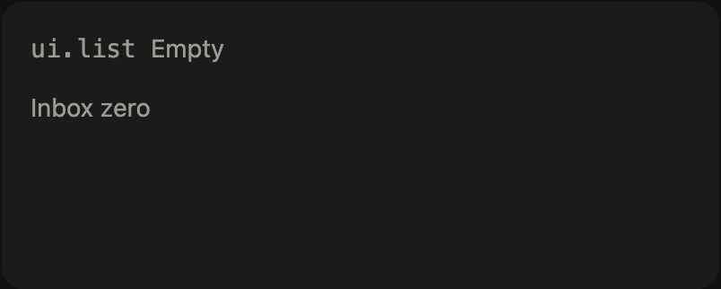

```lua
ui.list { empty = "Inbox zero" }
```

## ui.badge

A small count or label in a tone.


```lua
ui.group {
  direction = "row",
  gap = 2,
  ui.badge { text = "live", tone = "good" },
  ui.badge { text = 3, tone = "warn" },
  ui.badge { text = "down", tone = "bad" },
  ui.badge { text = "idle", tone = "muted" },
}
```

| Option | |
|---|---|
| `text` | a string or number |
| `tone` | `good`, `warn`, `bad` or `muted` |

## ui.icon

A Lucide icon by name, sized in pixels and colored like the text around it.


```lua
ui.group {
  direction = "row",
  gap = 4,
  ui.icon { name = "sun", size = 28 },
  ui.icon { name = "cloud-rain", size = 28 },
  ui.icon { name = "bell", size = 28 },
  ui.icon { name = "server", size = 28 },
}
```

| Option | |
|---|---|
| `name` | a Lucide icon name from web/src/widgets/icons.tsx |
| `size` | in px (default 20) |

### Any Lucide icon

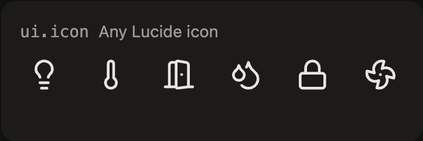

```lua
ui.group {
  direction = "row",
  gap = 4,
  ui.icon { name = "lightbulb", size = 28 },
  ui.icon { name = "thermometer", size = 28 },
  ui.icon { name = "door-open", size = 28 },
  ui.icon { name = "droplets", size = 28 },
  ui.icon { name = "lock", size = 28 },
  ui.icon { name = "fan", size = 28 },
}
```

## ui.toggle

On or off, iOS style: a switch in a row, a pill to slide (upright like a wall switch), or a Control Center tile. Flips at once; goes back and says why if the command fails.

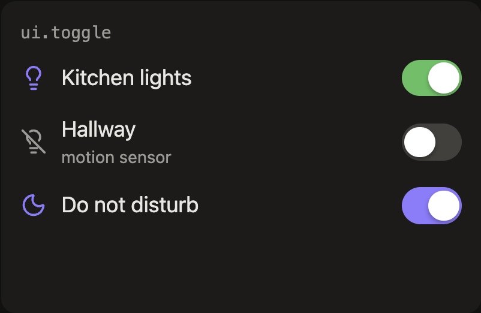

```lua
ui.group {
  direction = "column",
  gap = 4,
  ui.toggle {
    label = "Kitchen lights",
    icon = "lightbulb",
    icon_off = "lightbulb-off",
    on = true,
    on_change = cmd("light", { id = "kitchen" }),
  },
  ui.toggle {
    label = "Hallway",
    sub = "motion sensor",
    icon = "lightbulb",
    icon_off = "lightbulb-off",
    on = false,
    on_change = cmd("light", { id = "hall" }),
  },
  ui.toggle {
    label = "Do not disturb",
    icon = "moon",
    on = true,
    tone = "purple",
    on_change = cmd("dnd"),
  },
}
```

| Option | |
|---|---|
| `on` | the current state, from the module |
| `on_change` | `cmd("name", args)`: runs with `value = true` or `false` added to args |
| `label`, `sub` | text |
| `icon`, `icon_off` | a Lucide icon, and one for while it's off |
| `style` | `switch` (default), `slide` or `tile` |
| `orientation` | for `slide`: `horizontal` (default) or `vertical` |
| `tone` | the on color (default `good`, green) |

### Slide

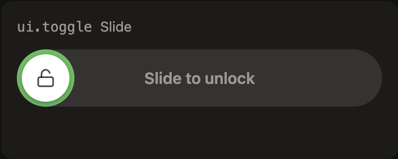

```lua
ui.toggle {
  label = "Slide to unlock",
  style = "slide",
  icon = "lock-open",
  on = false,
  on_change = cmd("door"),
}
```

### Upright slides

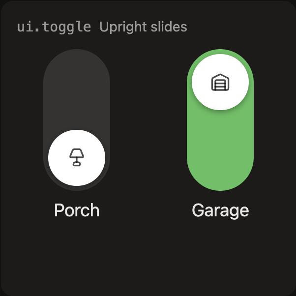

```lua
ui.group {
  direction = "row",
  gap = 6,
  ui.toggle {
    label = "Porch",
    style = "slide",
    orientation = "vertical",
    icon = "lamp",
    on = false,
    on_change = cmd("porch"),
  },
  ui.toggle {
    label = "Garage",
    style = "slide",
    orientation = "vertical",
    icon = "warehouse",
    on = true,
    on_change = cmd("garage"),
  },
}
```

### Tiles

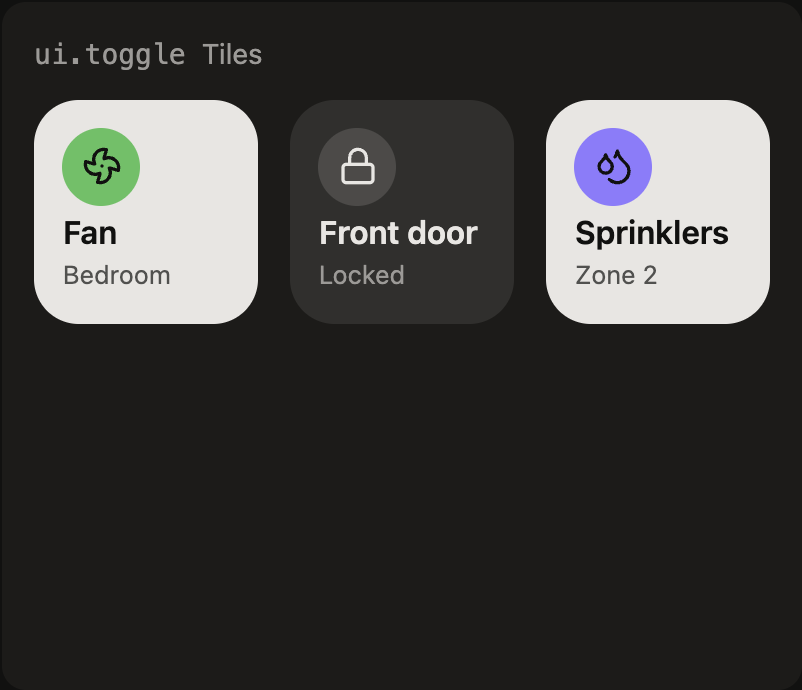

```lua
ui.group {
  direction = "row",
  gap = 4,
  ui.toggle {
    label = "Fan",
    style = "tile",
    icon = "fan",
    sub = "Bedroom",
    on = true,
    on_change = cmd("fan"),
  },
  ui.toggle {
    label = "Front door",
    style = "tile",
    icon = "lock",
    sub = "Locked",
    on = false,
    on_change = cmd("lock"),
  },
  ui.toggle {
    label = "Sprinklers",
    style = "tile",
    icon = "droplets",
    sub = "Zone 2",
    on = true,
    tone = "accent",
    on_change = cmd("zone", { id = 2 }),
  },
}
```

## ui.slider

A Control Center slider: a fat track that fills as you drag, horizontal or upright. Sends the value once, when let go.

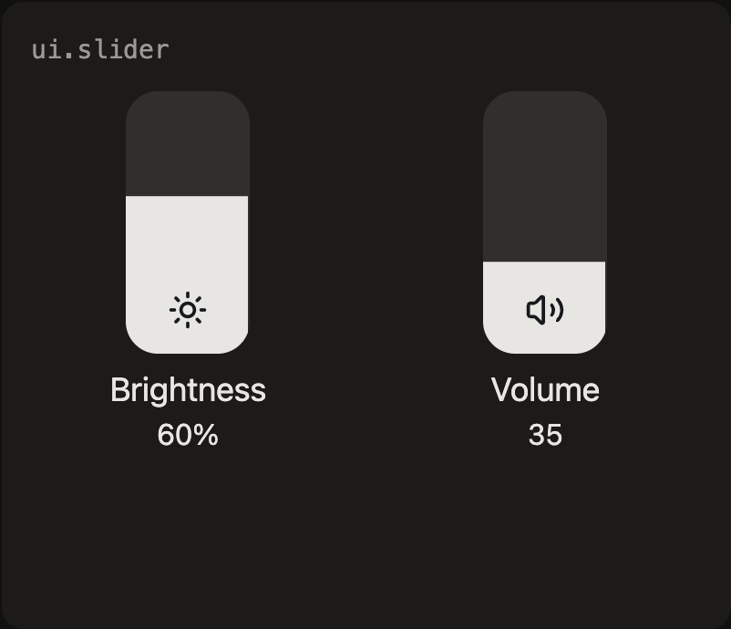

```lua
ui.group {
  direction = "row",
  gap = 6,
  ui.slider {
    label = "Brightness",
    icon = "sun",
    value = 60,
    unit = "%",
    orientation = "vertical",
    on_change = cmd("dim", { id = "kitchen" }),
  },
  ui.slider {
    label = "Volume",
    icon = "volume-2",
    value = 35,
    orientation = "vertical",
    on_change = cmd("volume"),
  },
}
```

| Option | |
|---|---|
| `value`, `min`, `max`, `step` | the current value (from the module) and its range (default 0 to 100, step 1) |
| `on_change` | `cmd("name", args)`: runs with `value` added, once you let go |
| `label`, `unit`, `icon` | text, a unit after the value, and a Lucide icon on the track |
| `orientation` | `horizontal` (default) or `vertical` |

### Horizontal

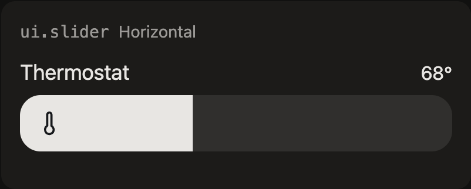

```lua
ui.slider {
  label = "Thermostat",
  icon = "thermometer",
  min = 60,
  max = 80,
  value = 68,
  unit = "°",
  on_change = cmd("thermostat"),
}
```

### Stepped

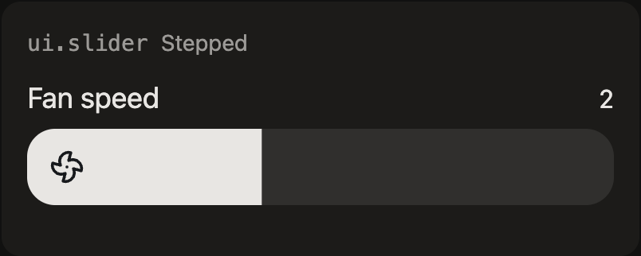

```lua
ui.slider {
  label = "Fan speed",
  icon = "fan",
  min = 0,
  max = 5,
  step = 1,
  value = 2,
  on_change = cmd("fan_speed"),
}
```

## ui.choice

Pick one of a few options: a scene, a mode. The current one is highlighted; tapping another runs the command.

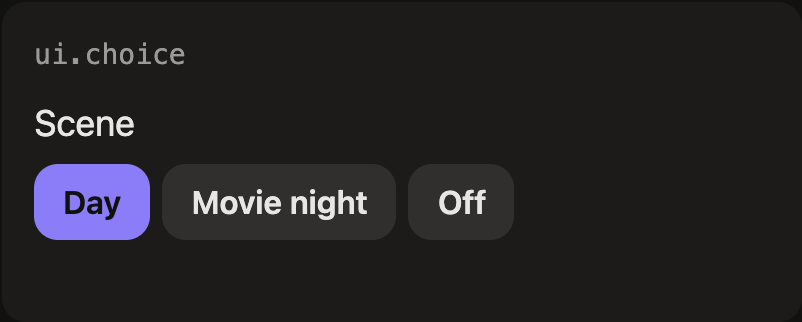

```lua
ui.choice {
  label = "Scene",
  value = "Day",
  options = { "Day", { value = "movie", label = "Movie night" }, "Off" },
  on_change = cmd("scene"),
}
```

| Option | |
|---|---|
| `options` | strings, or `{ value, label }` |
| `value` | the current option, from the module |
| `on_change` | `cmd("name", args)`: runs with `value` added |
| `label` | a caption |

### Modes

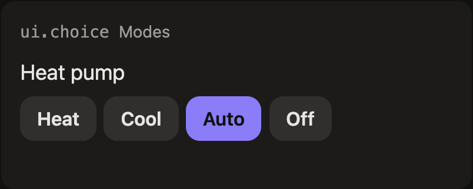

```lua
ui.choice {
  label = "Heat pump",
  value = "auto",
  options = { { value = "heat", label = "Heat" }, { value = "cool", label = "Cool" }, { value = "auto", label = "Auto" }, { value = "off", label = "Off" } },
  on_change = cmd("hvac_mode"),
}
```

## ui.button

Runs one of the module's commands when tapped: refresh, run a scene, snooze. Shows the command's error if it fails.

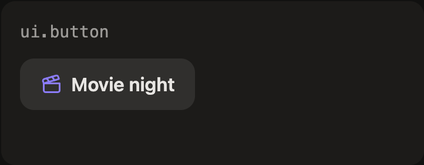

```lua
ui.button {
  label = "Movie night",
  icon = "clapperboard",
  on_tap = cmd("scene", { name = "movie" }),
}
```

| Option | |
|---|---|
| `label`, `icon` | text and a Lucide icon |
| `on_tap` | `cmd("name", args)`: the command it runs |

### A row of actions

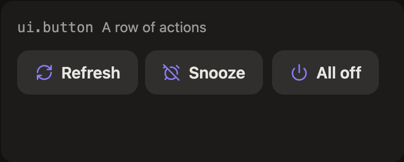

```lua
ui.group {
  direction = "row",
  gap = 3,
  ui.button { label = "Refresh", icon = "refresh-cw", on_tap = cmd("refresh") },
  ui.button {
    label = "Snooze",
    icon = "alarm-clock-off",
    on_tap = cmd("snooze", { minutes = 10 }),
  },
  ui.button { label = "All off", icon = "power", on_tap = cmd("all_off") },
}
```

## ui.image

An image, inline as base64 (`data`) or from a URL (`src`). Pairs with openrouter.image() for generated pictures.


```lua
local picture = openrouter.image(ctx, "A watercolor of the garden at dawn")  -- in fetch

ui.image { data = state.picture.data, type = state.picture.type, alt = "The garden at dawn" }
-- or: ui.image { src = "https://example.com/garden.jpg", alt = "The garden" }
```

| Option | |
|---|---|
| `data`, `type` | base64 image data and its type (default image/png); a full data: URL works too |
| `src` | an image URL, instead of data |
| `alt` | what the image shows |
| `fit` | `contain` (default) or `cover` |

## ui.audio

A clip with a play button, inline as base64 or from a URL. With autoplay, each new clip plays as it arrives: an announcement.


```lua
local clip = openrouter.speak(ctx, "Your 3pm is in ten minutes")  -- in fetch

ui.audio { data = state.clip.data, type = state.clip.type, label = "Next meeting", autoplay = true }
```

| Option | |
|---|---|
| `data`, `type` | base64 audio and its type (default audio/mpeg); a full data: URL works too |
| `src` | an audio URL, instead of data |
| `label` | shown beside the button |
| `autoplay` | `true` plays each new clip as it arrives (not the one already there when the page loads) |

## ui.title

A heading for a page or a group of panels, with no panel behind it. Themes can use the same thing as <Title> from @dashboard/layout.

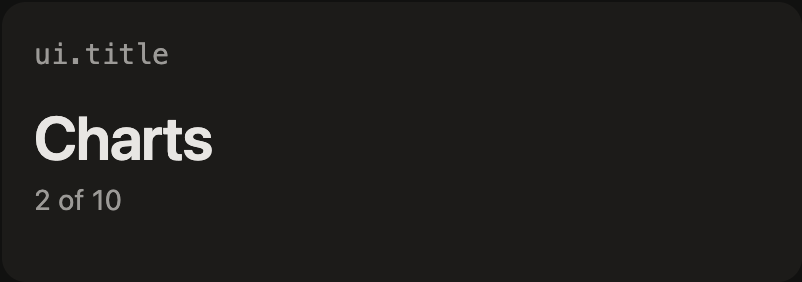

```lua
ui.title { text = "Charts", sub = "2 of 10" }
```

| Option | |
|---|---|
| `text`, `sub` | the title, and details |
| `align` | `left` (default), `center` or `right` |
| `details` | `below` (default), or `beside`: to the right of a left-aligned title, to the left of a right-aligned one |
| `icon` | a Lucide icon before the title |
| `size` | `small`, `medium` or `large` (default) |

### Centered, with an icon

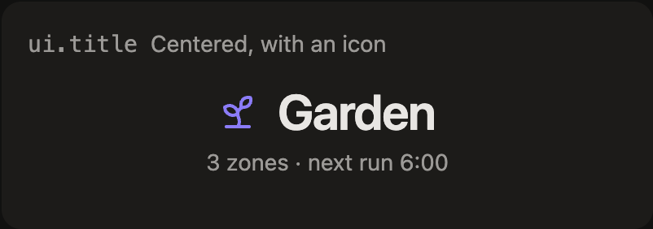

```lua
ui.title { text = "Garden", sub = "3 zones · next run 6:00", icon = "sprout", align = "center" }
```

### Details beside

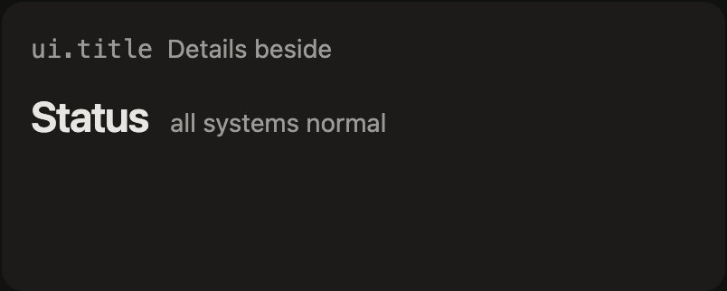

```lua
ui.title { text = "Status", sub = "all systems normal", details = "beside", size = "medium" }
```

### Right-aligned, details beside

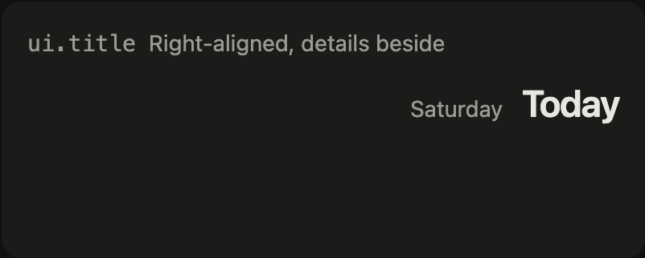

```lua
ui.title {
  text = "Today",
  sub = "Saturday",
  align = "right",
  details = "beside",
  size = "medium",
}
```

## ui.clock

A clock that ticks in the browser, digital or analog, in any time zone.


```lua
ui.clock { tz = "Europe/London", label = "London", date = "ddd, MMM D" }
```

| Option | |
|---|---|
| `tz` | an IANA time zone |
| `label` | a caption |
| `style` | `digital` or `analog` |
| `seconds` | `true` to show seconds |
| `format` | e.g. `h:mm a` |
| `date` | `true`, or a format like `dddd, MMMM D` |

### Analog

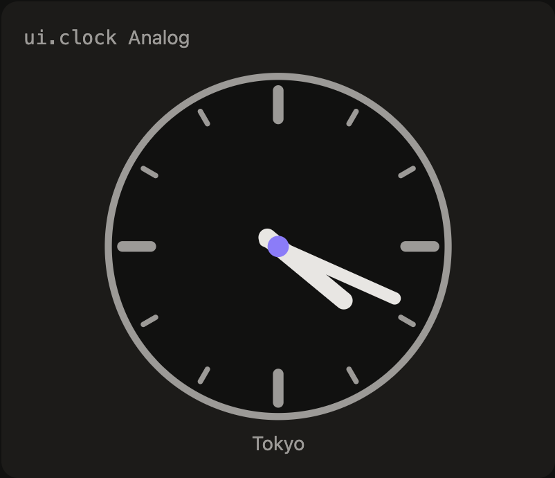

```lua
ui.clock { tz = "Asia/Tokyo", label = "Tokyo", style = "analog" }
```

### Seconds and 12-hour time

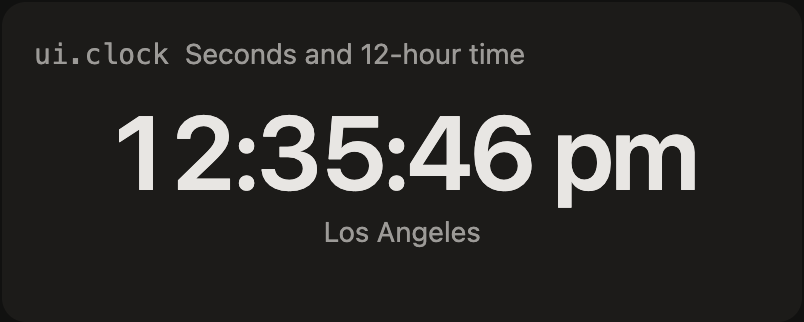

```lua
ui.clock {
  tz = "America/Los_Angeles",
  label = "Los Angeles",
  seconds = true,
  format = "h:mm:ss a",
}
```

## ui.group

Stacks other widgets in a row or a column. Most views are a group at the top.


```lua
ui.group {
  direction = "column",
  gap = 3,
  ui.group {
    direction = "row",
    gap = 6,
    ui.stat { value = "1.12", label = "Load", icon = "activity" },
    ui.stat { value = "23d", label = "Uptime", icon = "timer" },
  },
  ui.line {
    points = { 22, 25, 31, 28, 35, 41, 38, 33, 29, 34, 46, 52, 48, 41, 37, 33, 30, 36, 39, 35 },
    unit = "%",
    min = 0,
    max = 100,
  },
}
```

| Option | |
|---|---|
| `direction` | `column` (default) or `row` |
| `gap` | space between children, in quarter-rem steps |
| `(children)` | any widgets, as array entries or `children` |
